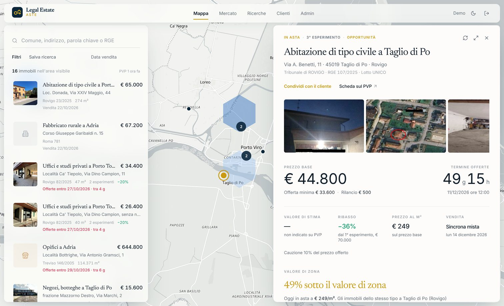

# Legal Estate · Aste

Internal tool for **Legal Estate** (Avv. Mariagiovanna Vella, Cadoneghe PD) to follow judicial
real-estate auctions. It replaces AstePlus with a map-first app built directly on the public data
of the **Portale delle Vendite Pubbliche** (`pvp.giustizia.it`), at near-zero running cost.

- National list of upcoming real-estate auctions (~17,700), refreshed nightly
- Full detail, round history, documents and geocoding for the Veneto courts (Padova, Vicenza,
  Treviso, Venezia, Rovigo), any other court on demand
- Map + list with filters, polygon search, property card with round timeline and discounts
- Internal notes, client links, read-only share links for clients
- Saved searches with a morning email digest of new lots, new rounds, price drops and new
  opportunities
- **Market analysis**: appraised €/m² per zone (≈2 km hexagons, comuni, provinces) from ~250,000
  court appraisals and auction prices since 2019, a quarterly price index, and **opportunities**
  (lots priced far below their zone) marked with a gold ring on the map. See
  [docs/market-analysis.md](docs/market-analysis.md)



More: [market page](docs/screenshots/market.jpg) · [property page](docs/screenshots/property-page.jpg) ·
[client share page](docs/screenshots/client-share-page.jpg) ·
[dark mode](docs/screenshots/dark-mode.jpg) · [mobile](docs/screenshots/mobile.jpg)

## Repository

```
backend/    FastAPI app (app/), ingestion CLI (ingest/), Alembic migrations, tests + PVP fixtures
frontend/   React + Vite + TypeScript, MapLibre (OpenFreeMap tiles), TanStack Query, Tailwind
docs/       pvp-api.md · data-model.md · market-analysis.md · decisions.md · runbook.md
```

## Run it locally

Requirements: Python 3.12+, Node 22, Postgres 16 with PostGIS (or Docker).

```bash
docker compose up -d db                      # or your own Postgres+PostGIS on :5432

cd backend
python -m venv .venv && . .venv/bin/activate
pip install -e ".[dev]"
cp .env.example .env                         # adjust DATABASE_URL / JWT_SECRET
alembic upgrade head
python -m ingest create-user you@example.org "Your Name" --admin
python -m ingest sync --scope veneto         # ~10 min the first time (polite: 1 req/s)
python -m ingest history --scope italy --since 2019-01-01   # market history, ~10 min, once
python -m ingest analytics                   # zone values and opportunities, ~20 s
uvicorn app.main:app --reload                # http://localhost:8000/docs

cd ../frontend
npm install
npm run dev                                  # http://localhost:5173
```

Tests: `cd backend && pytest` (needs a Postgres+PostGIS database, `TEST_DATABASE_URL`,
default `postgresql+psycopg://postgres@localhost:5432/aste_test`) and `cd frontend && npm test`.

## Deploy

See [docs/runbook.md](docs/runbook.md): Railway (API + nightly cron), Neon or Railway Postgres
with PostGIS, Vercel (frontend). About €5/month.

## Ground rules

- PVP is the only data source. Never scrape AstePlus.
- Be a polite PVP client: ≤ 1 request/second, backoff, nightly schedule.
- No debtor names, tax codes or judges' names are stored; professional contacts only behind
  `STORE_PROFESSIONAL_CONTACTS`; PDFs are linked, never mirrored.
